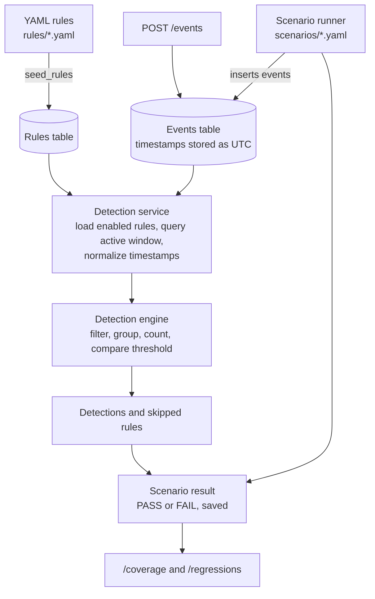

<div align="center">

# DetectLab

**A test-driven lab for building, validating and regression-testing security detections.**


</div>

---

DetectLab treats detection logic as testable software. Rules are written in YAML,
events are submitted through a REST API, and **scenarios** replay known event
sequences to prove that a rule fires when it should and stays quiet when it
should not. Every scenario run is recorded, so rule coverage and regressions
are visible over time.

> **Scope.** DetectLab is a learning and portfolio project. It is not a SIEM, a
> SOC platform or a production monitoring product, and it does not collect or
> parse operating-system logs. Events are submitted through its API.

## At a glance

| | |
|---|---|
| **API** | FastAPI on Uvicorn, interactive docs at `/docs` |
| **Storage** | SQLite via SQLAlchemy |
| **Rule format** | YAML, validated on creation and again at evaluation |
| **Detection model** | Threshold counting, with optional distinct-value counting |
| **Shipped rules** | 3 (`DET-001` to `DET-003`) |
| **Shipped scenarios** | 31 (`SCN-001` to `SCN-031`), positive, negative and boundary cases |
| **Automated tests** | 200 (pytest) |
| **Environment** | Python 3.13, developed on Windows with PowerShell |

## Contents

- [Why DetectLab](#why-detectlab)
- [Architecture](#architecture)
- [Shipped detection rules](#shipped-detection-rules)
- [Detection semantics](#detection-semantics)
- [Scenario testing](#scenario-testing)
- [Quick start](#quick-start)
- [API reference](#api-reference)
- [Project structure](#project-structure)
- [Testing](#testing)
- [Benchmark](#benchmark)
- [Engineering notes](#engineering-notes)
- [Limitations and security notes](#limitations-and-security-notes)
- [Possible next steps](#possible-next-steps)

## Why DetectLab

Detection rules fail in quiet ways: counting the wrong events, grouping
activity incorrectly, including events outside the time window, or triggering
when a required field is missing. DetectLab makes those failure modes
checkable.

- **Configuration-driven rules.** Detection logic lives in YAML, separate from application code.
- **Executable scenarios.** Known event sequences are evaluated and the PASS or FAIL result is saved.
- **Negative testing.** A scenario can assert that a detection must be *absent*, which guards against false positives.
- **Boundary testing.** Time-window edges are pinned down by tests, including an event exactly at the window start.
- **Regression visibility.** Coverage and latest-run status are reported per rule.
- **Deliberately small engine.** Understandable, well-tested threshold behavior is preferred over a broad but shallow feature set.

## Architecture



1. The service loads **enabled** rules and parses their YAML definitions.
2. It queries events inside the largest active rule window and normalizes timestamps to timezone-aware UTC.
3. The engine evaluates each rule against the events.
4. An invalid rule is reported as **skipped** without stopping the others.
5. Results are returned by the API. Results from `/detections/evaluate` are not persisted; scenario results are.

## Shipped detection rules

| Rule | Detects | Window | Grouping | Counts | MITRE ATT&CK |
|---|---|---|---|---|---|
| `DET-001` Multiple Failed Logins | 5+ failed logins | 60 s | host, user | events | T1110.001 |
| `DET-002` SSH Brute Force From Single Source | 10+ failed SSH logins | 120 s | host, source IP | events | T1110.001 |
| `DET-003` Password Spraying From Single Source | failures across 5+ distinct users | 300 s | host, source IP | distinct users | T1110.003 |

<details>
<summary><b>DET-001: Multiple Failed Logins</b></summary>

Detects five or more `authentication_failure` events for the same host and user
inside 60 seconds. Platform: Windows.

- **Possible false positives:** mistyped passwords, stale saved credentials, misconfigured services.
- **Blind spots:** guessing slower than the window, and attempts spread across many accounts.
- **Implementation note:** it counts the configured event type and does not filter on the `status` field.

</details>

<details>
<summary><b>DET-002: SSH Brute Force From Single Source</b></summary>

Detects ten or more `ssh_authentication_failure` events from the same source IP
against the same host inside 120 seconds. Platform: Linux.

- **Possible false positives:** misconfigured automation, repeated attempts with an invalid key.
- **Blind spots:** slow attempts, and distributed attempts where each source stays below the threshold.
- **Scope note:** `ssh_authentication_failure` is a DetectLab event type. The project does not parse real `auth.log` files.

</details>

<details>
<summary><b>DET-003: Password Spraying From Single Source</b></summary>

Detects `authentication_failure` events from one source IP against one host
involving five or more **distinct users** inside 300 seconds. Platform: Windows.
`DET-001` misses this pattern because each account fails only once or twice.

- **Possible false positives:** shared workstations, NAT gateways, service-account sweeps.
- **Blind spots:** spraying slower than five accounts in five minutes, and activity spread across many source IPs.
- **Implementation note:** with `distinct_field: user`, repeated failures for the same user do not raise the count.

</details>

> These detections are **signals, not proof** that an attack occurred. Real
> investigations need identity, endpoint, network and business context.

### Rule format

Rules live in `rules/` as YAML. The file name must match the rule `id`.

```yaml
id: DET-001
name: Multiple Failed Logins
description: Detects repeated failed authentication attempts.
platform: windows
severity: medium
mitre_technique: T1110.001      # optional metadata
condition:
  type: threshold               # the only supported condition type
  event_type: authentication_failure
  count: 5                      # positive integer
  window_seconds: 60            # positive integer
  group_by:                     # non-empty, unique field names
    - host
    - user
```

Required fields: `id`, `name`, `description`, `platform`, `severity`, `condition`.
`group_by` fields come from the event's `host` or from `event_data` (for
example `user` or `source_ip`). Rules with any other condition type are
rejected.

**Distinct-value counting.** Add `distinct_field` to count unique values per
group instead of raw events:

```yaml
condition:
  type: threshold
  event_type: authentication_failure
  count: 5                 # five distinct users, not five events
  window_seconds: 300
  distinct_field: user
  group_by:
    - host
    - source_ip
```

`distinct_field` must be a non-empty string and must not also appear in
`group_by`. Events missing the field, or holding an unhashable value, are
ignored. Rules without `distinct_field` behave exactly as before.

## Detection semantics

These behaviors are covered by automated tests.

- **Window:** `(evaluation_time - window_seconds, evaluation_time]`. An event exactly at the start is excluded, an event exactly at the evaluation time is included, and future events are excluded.
- **Grouping:** events are grouped by the combination of every `group_by` value, so different hosts, users or sources produce separate detections.
- **Threshold:** a group triggers when its count is **at least** `count` (or, with `distinct_field`, when its distinct-value count is). More events than the threshold still produce one detection per group.
- **Bad data:** events with a missing group field, a naive or non-datetime timestamp, or an unhashable group value are ignored.
- **Isolation:** one invalid rule is skipped and reported without stopping evaluation of the others.
- **Time zones:** the evaluation time must be timezone-aware. Event timestamps submitted through the API must include a timezone and are converted to UTC before storage.
- **Single window:** the engine evaluates one window ending at the evaluation time. It does not slide across history.

An example detection:

```json
{
  "rule_id": "DET-001",
  "count": 5,
  "threshold": 5,
  "window_seconds": 60,
  "window_start": "2026-10-24T11:59:00Z",
  "window_end": "2026-10-24T12:00:00Z",
  "group": { "host": "WIN11-LAB", "user": "scenario-test-user" }
}
```

Rules that use `distinct_field` also report `distinct_field` and `event_count`
(the total matching events, including repeats).

## Scenario testing

A scenario in `scenarios/` names a host, a sequence of events, the rule under
test and the expected outcome.

| `expected_detection` | The scenario passes when |
|---|---|
| `true` | the expected rule detects on the expected host |
| `false` | that detection is **absent** |

A `PASS` therefore means observed behavior matched the scenario's expectation.
It does not necessarily mean an attack was detected.

The shipped library contains **31 scenarios** (`SCN-001` to `SCN-031`) covering
positive cases, negative cases and time-window boundary tests.

`/coverage` reports, per rule, how many scenario runs passed and failed.
`/regressions` reports the latest-run status of each rule:
`HEALTHY`, `REGRESSION`, `UNTESTED` or `UNKNOWN`.

> Scenario runs insert real events and run records into the configured
> database. Use a disposable database when experimenting. Each scenario names
> the host it targets, and that host must exist before the scenario runs.

To add your own rule and scenario, see [docs/ADDING_A_RULE.md](docs/ADDING_A_RULE.md).

## Quick start

Developed and tested with Python 3.13 on Windows. Run these from the repository
root in PowerShell.

```powershell
python -m venv .venv
.\.venv\Scripts\Activate.ps1
pip install -r requirements.txt

python -m app.init_db          # creates data/detectlab.db and its tables
python -m app.seed_rules       # loads rules/*.yaml (idempotent, never overwrites)
python -m uvicorn app.main:app --reload
```

| | |
|---|---|
| API base URL | <http://127.0.0.1:8000> |
| Interactive docs | <http://127.0.0.1:8000/docs> |
| Health check | `GET /health` |

### Run your first scenarios

With the API running, use a second PowerShell terminal:

```powershell
# Create the lab hosts the first three scenarios target
Invoke-RestMethod -Method Post -Uri http://127.0.0.1:8000/api/v1/hosts `
  -ContentType "application/json" `
  -Body '{"hostname":"WIN11-LAB","platform":"windows","ip_address":"192.168.56.10"}'

Invoke-RestMethod -Method Post -Uri http://127.0.0.1:8000/api/v1/hosts `
  -ContentType "application/json" `
  -Body '{"hostname":"UBUNTU-LAB","platform":"linux","ip_address":"192.168.56.20"}'

# Run scenarios
Invoke-RestMethod -Method Post -Uri http://127.0.0.1:8000/api/v1/scenarios/library/SCN-001/run
Invoke-RestMethod -Method Post -Uri http://127.0.0.1:8000/api/v1/scenarios/library/SCN-002/run
Invoke-RestMethod -Method Post -Uri http://127.0.0.1:8000/api/v1/scenarios/library/SCN-003/run

# Inspect results
Invoke-RestMethod http://127.0.0.1:8000/api/v1/scenarios/runs
Invoke-RestMethod http://127.0.0.1:8000/api/v1/coverage
Invoke-RestMethod http://127.0.0.1:8000/api/v1/regressions
```

| Scenario | Host | Rule | Events |
|---|---|---|---|
| `SCN-001` | `WIN11-LAB` | `DET-001` | five failed logins for one user |
| `SCN-002` | `UBUNTU-LAB` | `DET-002` | ten SSH failures from one source IP |
| `SCN-003` | `WIN11-LAB` | `DET-003` | one source IP failing for five distinct users |

## API reference

All routes are under `/api/v1` except `/health`. The full schema is at `/docs`.

| Method | Path | Purpose |
|---|---|---|
| `GET` | `/health` | Health check |
| `POST`, `GET` | `/hosts` | Create and list hosts |
| `POST`, `GET` | `/rules` | Create validated rules and list rules |
| `POST`, `GET` | `/events` | Ingest and list events |
| `POST` | `/detections/evaluate` | Evaluate enabled rules at a given time (not persisted) |
| `POST` | `/detections/validate` | Check whether an expected rule detection is present or absent on an expected host |
| `POST` | `/scenarios/run` | Run an inline scenario and save the result |
| `POST` | `/scenarios/library/{scenario_id}/run` | Run a shipped scenario |
| `GET` | `/scenarios/runs`, `/scenarios/runs/{run_id}` | Scenario run history |
| `GET` | `/coverage` | Scenario coverage per rule |
| `GET` | `/regressions` | Latest scenario status per rule |

## Project structure

```text
app/
  main.py                  FastAPI app and router registration
  models.py                SQLAlchemy models
  database.py              SQLite connection and session setup
  schemas.py               Request and response models
  seed_rules.py            Loads rules/*.yaml into the database
  detection/
    engine.py              Rule validation and threshold evaluation
    service.py             Database-backed evaluation of enabled rules
    rule_validator.py      Validation of rules at creation time
    scenario.py            Scenario runner
    scenario_library.py    YAML scenario loader
rules/                     Shipped detection rules
scenarios/                 Shipped test scenarios
benchmarks/                Detection-service benchmark
docs/                      Guides
tests/                     Automated tests
```

## Testing

```powershell
python -m pytest -q
```

The suite covers the detection engine, the database-backed service, the API,
rule validation, scenario execution, rule seeding and timestamp handling,
including window boundaries, grouping, missing and malformed data, and invalid
rule configurations. The most recent full run passed all 200 tests.

Passing tests demonstrate the behavior listed above. They are not a claim of
production readiness or completeness.

## Benchmark

```powershell
python -m benchmarks.benchmark_detection_service
```

The benchmark runs the detection service against an **in-memory** SQLite
database with 5, 10 and 20 rules and 1,000, 5,000 and 10,000 events, in two
workloads: *historical-heavy* (only five recent events) and *recent-heavy*
(80% recent). It reports the median wall-clock time over five runs.

Timings are for comparing code changes on the same machine and workload, not
for absolute capacity claims. The benchmark checks that every rule is evaluated
and none skipped; it does not compare detection output between implementations.

## Engineering notes

- **Query bounded by active rule windows.** The service queries only events inside the largest enabled-rule window. In the historical-heavy workload, runtime stayed nearly flat as stored events grew from 1,000 to 10,000.
- **A rejected optimization.** An in-memory event-type index was implemented and benchmarked. It showed no consistent speedup and was slower in most recent-heavy cases, so it was removed rather than kept as extra complexity.
- **UTC normalization at ingest.** A regression test showed that an event submitted with a non-UTC offset was stored at the wrong instant, which would silently shift it out of a detection window. Timestamps are now converted to UTC on input, and stored values are serialized as UTC in responses.
- **Validator and engine kept in agreement.** Rule creation now rejects condition types the engine cannot evaluate, instead of accepting them and skipping them at runtime.
- **Backward-compatible extension.** `distinct_field` was added without changing the output of existing rules, and the original rule tests act as the regression guard.
- **Reproducible setup.** The install and quick start were verified from a fresh clone in a clean virtual environment.

## Limitations and security notes

- SQLite only. Tables are created with `create_all`; there is no migration system.
- One condition type (`threshold`) and three shipped rules.
- No log collection or parsing of real Windows Event Logs or Linux `auth.log` files.
- **No authentication or authorization.** Do not expose the API to untrusted networks.
- Results from `/detections/evaluate` are not persisted.
- No alert lifecycle, deduplication, suppression or cross-rule correlation.
- Rules cannot currently be updated, deleted or enabled and disabled through the API.
- The database URL is hard-coded in `app/database.py`.
- `python -m app.seed_rules` never overwrites an existing rule, so editing a rule file after it has been seeded does not update the database.

## Possible next steps

These are ideas, not implemented features.

- Rule management endpoints (update, delete, enable and disable).
- Additional condition types and more shipped rules.
- Configurable database location.
- Persisted detections and an alert lifecycle.
- Parsers for real log formats.

<!--
Screenshots: add images under docs/images/ and embed them here once captured, e.g.

Suggested: Swagger UI, a positive scenario PASS, a negative scenario PASS,
and the /coverage and /regressions output.
-->

## Author

**Yogesh Joshi**: security detection engineering and backend development

- GitHub: [@0xjoshi](https://github.com/0xjoshi)
- Repository: [github.com/0xjoshi/detectlab](https://github.com/0xjoshi/detectlab)

## License

See [LICENSE](LICENSE).