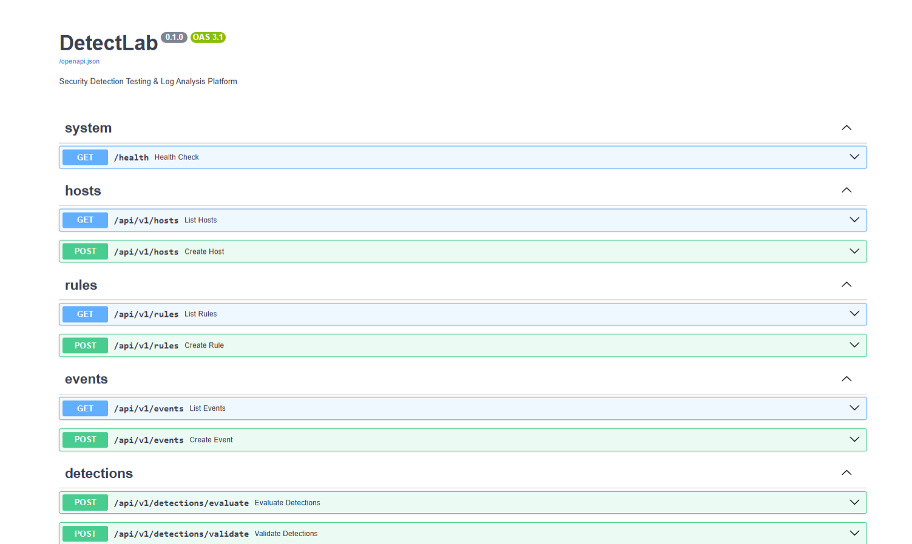
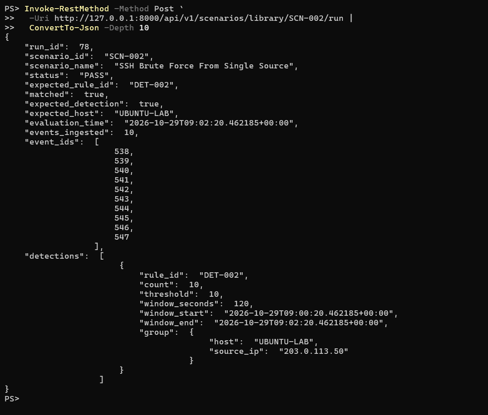
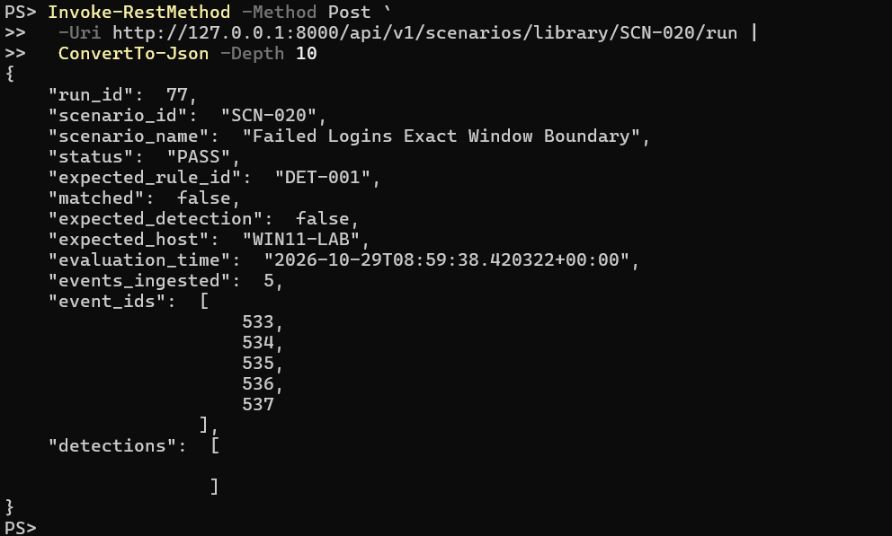
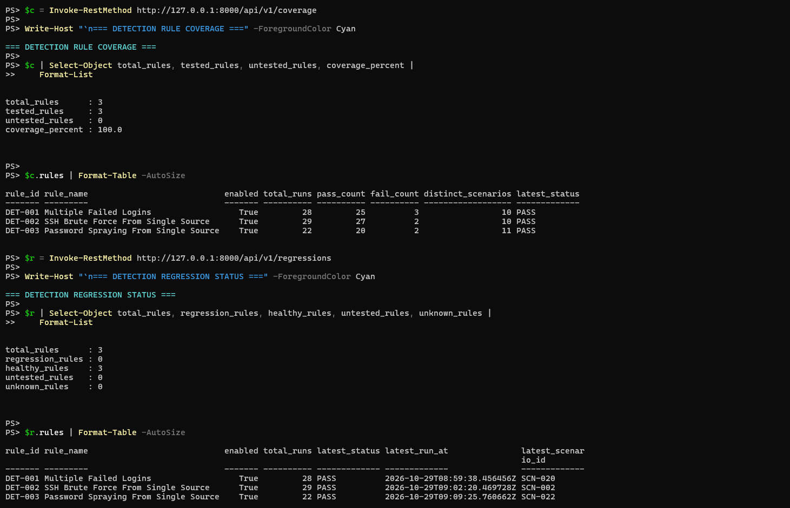
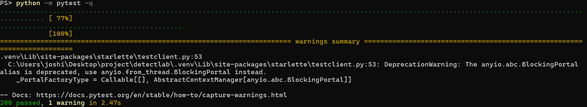

<div align="center">

# 🛡️ DetectLab

### Detection rules are code. Test them like code.

**Write a rule. Replay the attack. Prove it fires, and prove it stays quiet.**


[Quick start](#-quick-start) · [Rules](#-shipped-detection-rules) · [Scenarios](#-scenario-testing) · [API](#-api-reference) · [Design choices](#-the-design-choices-that-actually-matter)

</div>

---

Writing a detection rule takes minutes. **Knowing it works takes proof.**

Most rule collections ship YAML and hope. Was the threshold off by one? Does the
window include the event sitting exactly on its edge? Does the rule fire on
sparse, noisy data it should ignore? Does last week's refactor still catch what
it caught before?

DetectLab answers those with evidence. Rules are YAML, events arrive through a
REST API, and **scenarios** replay known event sequences against the rules and
record a PASS or FAIL, for attacks that must be caught *and* for activity that
must be ignored.

> **Scope.** DetectLab is a learning and portfolio project. It is not a SIEM, a
> SOC platform or a production monitoring product, and it does not collect or
> parse operating-system logs. Events are submitted through its API.

## 📊 By the numbers

| 3 | 31 | 200 | 2 |
|:---:|:---:|:---:|:---:|
| **shipped rules**<br/>`DET-001` to `DET-003` | **scenarios**<br/>positive, negative and boundary | **automated tests**<br/>engine, service, API, scenarios | **MITRE sub-techniques**<br/>T1110.001 and T1110.003 |

## 🧬 Why this isn't just another rule repo

| A typical rule collection | DetectLab |
|---|---|
| Rule files, no proof they work | Every rule is exercised by executable scenarios |
| Only tests that the rule *fires* | Also tests that it stays **quiet** (`expected_detection: false`) |
| Window edges left to interpretation | `(start, end]` is defined, documented and pinned by tests |
| "It worked last month" | `/coverage` and `/regressions` show each rule's latest verdict |
| Counts events, nothing else | Optional **distinct-value counting**, which catches password spraying |
| One bad rule can break the batch | An invalid rule is skipped and reported; the rest still run |

## 🖥️ What you actually see

```text
PS> Invoke-RestMethod -Method Post -Uri http://127.0.0.1:8000/api/v1/scenarios/library/SCN-002/run

run_id           : 7
scenario_id      : SCN-002
scenario_name    : SSH Brute Force From Single Source
status           : PASS
expected_rule_id : DET-002
matched          : True
expected_host    : UBUNTU-LAB
events_ingested  : 10
detections       : {@{rule_id=DET-002; count=10; threshold=10; window_seconds=120; ...}}

PS> Invoke-RestMethod http://127.0.0.1:8000/api/v1/coverage

total_rules      : 3
tested_rules     : 3
untested_rules   : 0
coverage_percent : 100.0
```

## ⚙️ The pipeline

```text
   📝              📥               🔎                 ✅                 📈
  RULES   ──▶    EVENTS    ──▶   EVALUATE    ──▶    SCENARIO    ──▶   COVERAGE AND
 (YAML)        (REST API,        (window, group,     VERDICT           REGRESSION
                UTC-normalized)   threshold)         (PASS / FAIL)     STATUS
```

| | Stage | What happens |
|---|---|---|
| 📝 | **Define** | Detection logic lives in `rules/*.yaml`. Rules are validated when created and validated again when evaluated. |
| 📥 | **Ingest** | Hosts and events arrive through the API. Timestamps must carry a timezone and are stored as UTC. |
| 🔎 | **Evaluate** | The service loads enabled rules, queries only events inside the largest active window, and the engine filters, groups, counts and compares against the threshold. |
| ✅ | **Prove** | A scenario inserts a known event sequence, evaluates the rule under test and saves a PASS or FAIL against its expectation. |
| 📈 | **Track** | `/coverage` and `/regressions` summarize scenario history per rule: `HEALTHY`, `REGRESSION`, `UNTESTED` or `UNKNOWN`. |

## 🎯 Shipped detection rules

| Rule | Detects | Window | Grouped by | Counts | MITRE ATT&CK |
|---|---|:---:|---|---|---|
| `DET-001` **Multiple Failed Logins** | 5+ failed logins | 60 s | host, user | events | T1110.001 |
| `DET-002` **SSH Brute Force From Single Source** | 10+ failed SSH logins | 120 s | host, source IP | events | T1110.001 |
| `DET-003` **Password Spraying From Single Source** | failures across 5+ distinct users | 300 s | host, source IP | distinct users | T1110.003 |

<details>
<summary><b>DET-001: Multiple Failed Logins</b></summary>

Five or more `authentication_failure` events for the same host and user inside
60 seconds. Platform: Windows.

- **Possible false positives:** mistyped passwords, stale saved credentials, misconfigured services.
- **Blind spots:** guessing slower than the window, and attempts spread across many accounts.
- **Implementation note:** it counts the configured event type and does not filter on the `status` field.

</details>

<details>
<summary><b>DET-002: SSH Brute Force From Single Source</b></summary>

Ten or more `ssh_authentication_failure` events from one source IP against one
host inside 120 seconds. Platform: Linux.

- **Possible false positives:** misconfigured automation, repeated attempts with an invalid key.
- **Blind spots:** slow attempts, and distributed attempts where each source stays below the threshold.
- **Scope note:** `ssh_authentication_failure` is a DetectLab event type. The project does not parse real `auth.log` files.

</details>

<details>
<summary><b>DET-003: Password Spraying From Single Source</b></summary>

`authentication_failure` events from one source IP against one host involving
five or more **distinct users** inside 300 seconds. Platform: Windows.
`DET-001` misses this pattern because each account fails only once or twice.

- **Possible false positives:** shared workstations, NAT gateways, service-account sweeps.
- **Blind spots:** spraying slower than five accounts in five minutes, and activity spread across many source IPs.
- **Implementation note:** with `distinct_field: user`, repeated failures for the same user do not raise the count.

</details>

> 🚨 These detections are **signals, not proof** that an attack occurred. Real
> investigations need identity, endpoint, network and business context.

### Rule format

Rules live in `rules/` as YAML. The file name must match the rule `id`.

```yaml
id: DET-001
name: Multiple Failed Logins
description: Detects repeated failed authentication attempts.
platform: windows
severity: medium
mitre_technique: T1110.001      # optional metadata
condition:
  type: threshold               # the only supported condition type
  event_type: authentication_failure
  count: 5                      # positive integer
  window_seconds: 60            # positive integer
  group_by:                     # non-empty, unique field names
    - host
    - user
```

Required fields: `id`, `name`, `description`, `platform`, `severity`, `condition`.
`group_by` fields come from the event's `host` or from `event_data` (for example
`user` or `source_ip`). Rules with any other condition type are rejected.

**Distinct-value counting.** Add `distinct_field` to count unique values per
group instead of raw events:

```yaml
condition:
  type: threshold
  event_type: authentication_failure
  count: 5                 # five distinct users, not five events
  window_seconds: 300
  distinct_field: user
  group_by:
    - host
    - source_ip
```

`distinct_field` must be a non-empty string and must not also appear in
`group_by`. Events missing the field, or holding an unhashable value, are
ignored. Rules without `distinct_field` behave exactly as before.

### Detection semantics

These behaviors are covered by automated tests.

- ⏱️ **Window:** `(evaluation_time - window_seconds, evaluation_time]`. An event exactly at the start is excluded, an event exactly at the evaluation time is included, and future events are excluded.
- 🧩 **Grouping:** events are grouped by the combination of every `group_by` value, so different hosts, users or sources produce separate detections.
- 📏 **Threshold:** a group triggers when its count is **at least** `count` (or, with `distinct_field`, when its distinct-value count is). More events than the threshold still produce one detection per group.
- 🧹 **Bad data:** events with a missing group field, a naive or non-datetime timestamp, or an unhashable group value are ignored.
- 🔒 **Isolation:** one invalid rule is skipped and reported without stopping the others.
- 🌍 **Time zones:** the evaluation time must be timezone-aware. Event timestamps submitted through the API must include a timezone and are converted to UTC before storage.
- 🪟 **Single window:** the engine evaluates one window ending at the evaluation time. It does not slide across history.

<details>
<summary><b>Example detection output</b></summary>

```json
{
  "rule_id": "DET-001",
  "count": 5,
  "threshold": 5,
  "window_seconds": 60,
  "window_start": "2026-10-24T11:59:00Z",
  "window_end": "2026-10-24T12:00:00Z",
  "group": { "host": "WIN11-LAB", "user": "scenario-test-user" }
}
```

Rules that use `distinct_field` also report `distinct_field` and `event_count`
(the total matching events, including repeats).

</details>

## 🧪 Scenario testing

A scenario in `scenarios/` names a host, a sequence of events, the rule under
test and the expected outcome.

| `expected_detection` | The scenario passes when |
|---|---|
| `true` | the expected rule detects on the expected host |
| `false` | that detection is **absent** |

A `PASS` means observed behavior matched the scenario's expectation. It does
not necessarily mean an attack was detected.

The shipped library holds **31 scenarios** (`SCN-001` to `SCN-031`) covering
positive cases, negative cases and time-window boundary tests.

> ⚠️ Scenario runs insert real events and run records into the configured
> database. Use a disposable database when experimenting. Each scenario names
> the host it targets, and that host must exist before the scenario runs.

To add your own rule and scenario, see [docs/ADDING_A_RULE.md](docs/ADDING_A_RULE.md).

## ⚡ Everything it does

**🎯 Detection**

- 📝 YAML-defined threshold rules with validation on creation and at evaluation
- 🧮 Optional distinct-value counting for spraying-style patterns
- 🧩 Multi-field grouping (host, user, source IP, or any `event_data` field)
- ⏱️ Precisely defined, boundary-tested time windows

**🚀 Built to be used and trusted**

- 🧪 Positive, negative and boundary scenarios with saved PASS or FAIL results
- 📈 Per-rule coverage and regression status
- 🌍 UTC normalization at ingest, with UTC timestamps in API responses
- 🔌 Interactive API docs at `/docs`
- 📊 A repeatable performance benchmark

## 🔬 The design choices that actually matter

- 🧱 **Small engine, strong guarantees.** One well-tested condition type beats a broad, shallow rule language.
- ⏱️ **Window semantics are explicit.** The half-open window `(start, end]` is documented and pinned by tests, including the event sitting exactly on the start boundary.
- ⚡ **Bounded queries.** The service loads only events inside the largest enabled-rule window. In the historical-heavy benchmark, runtime stayed nearly flat as stored events grew from 1,000 to 10,000.
- ✂️ **A rejected optimization.** An in-memory event-type index was built and benchmarked. It showed no consistent gain and was slower in most recent-heavy cases, so it was removed instead of kept as extra complexity.
- 🌍 **A bug found by a test, not by luck.** A regression test showed that an event with a non-UTC offset was stored at the wrong instant, silently pushing it out of a detection window. Timestamps are now converted to UTC at ingest.
- 🤝 **Validator and engine agree.** Rule creation rejects condition types the engine cannot evaluate, rather than accepting them and skipping them at runtime.
- 🔁 **Backward-compatible extension.** `distinct_field` was added without changing the output of existing rules, and the original rule tests served as the regression guard.
- 🧰 **Reproducible setup.** The install and quick start were verified from a fresh clone in a clean virtual environment.

## 🚀 Quick start

Developed and tested with Python 3.13 on Windows. Run these from the repository
root in PowerShell.

```powershell
python -m venv .venv
.\.venv\Scripts\Activate.ps1
pip install -r requirements.txt

python -m app.init_db          # creates data/detectlab.db and its tables
python -m app.seed_rules       # loads rules/*.yaml (idempotent, never overwrites)
python -m uvicorn app.main:app --reload
```

| | |
|---|---|
| 🌐 API base URL | <http://127.0.0.1:8000> |
| 📖 Interactive docs | <http://127.0.0.1:8000/docs> |
| ❤️ Health check | `GET /health` |

### Run your first scenarios

With the API running, open a second PowerShell terminal:

```powershell
# Create the lab hosts the first three scenarios target
Invoke-RestMethod -Method Post -Uri http://127.0.0.1:8000/api/v1/hosts `
  -ContentType "application/json" `
  -Body '{"hostname":"WIN11-LAB","platform":"windows","ip_address":"192.168.56.10"}'

Invoke-RestMethod -Method Post -Uri http://127.0.0.1:8000/api/v1/hosts `
  -ContentType "application/json" `
  -Body '{"hostname":"UBUNTU-LAB","platform":"linux","ip_address":"192.168.56.20"}'

# Run scenarios
Invoke-RestMethod -Method Post -Uri http://127.0.0.1:8000/api/v1/scenarios/library/SCN-001/run
Invoke-RestMethod -Method Post -Uri http://127.0.0.1:8000/api/v1/scenarios/library/SCN-002/run
Invoke-RestMethod -Method Post -Uri http://127.0.0.1:8000/api/v1/scenarios/library/SCN-003/run

# Inspect results
Invoke-RestMethod http://127.0.0.1:8000/api/v1/scenarios/runs
Invoke-RestMethod http://127.0.0.1:8000/api/v1/coverage
Invoke-RestMethod http://127.0.0.1:8000/api/v1/regressions
```

| Scenario | Host | Rule | Events |
|---|---|---|---|
| `SCN-001` | `WIN11-LAB` | `DET-001` | five failed logins for one user |
| `SCN-002` | `UBUNTU-LAB` | `DET-002` | ten SSH failures from one source IP |
| `SCN-003` | `WIN11-LAB` | `DET-003` | one source IP failing for five distinct users |

Run the test suite:

```powershell
python -m pytest -q
```

## 🔌 API reference

All routes are under `/api/v1` except `/health`. The full schema is at `/docs`.

| Method | Path | Purpose |
|---|---|---|
| `GET` | `/health` | Health check |
| `POST`, `GET` | `/hosts` | Create and list hosts |
| `POST`, `GET` | `/rules` | Create validated rules and list rules |
| `POST`, `GET` | `/events` | Ingest and list events |
| `POST` | `/detections/evaluate` | Evaluate enabled rules at a given time (not persisted) |
| `POST` | `/detections/validate` | Check whether an expected rule detection is present or absent on an expected host |
| `POST` | `/scenarios/run` | Run an inline scenario and save the result |
| `POST` | `/scenarios/library/{scenario_id}/run` | Run a shipped scenario |
| `GET` | `/scenarios/runs`, `/scenarios/runs/{run_id}` | Scenario run history |
| `GET` | `/coverage` | Scenario coverage per rule |
| `GET` | `/regressions` | Latest scenario status per rule |

## 🗂️ Structure

```text
DetectLab/
├── 🧠 app/
│   ├── main.py                 FastAPI app and router registration
│   ├── models.py               SQLAlchemy models
│   ├── database.py             SQLite connection and session setup
│   ├── schemas.py              Request and response models
│   ├── seed_rules.py           Loads rules/*.yaml into the database
│   └── detection/
│       ├── engine.py           Rule validation and threshold evaluation
│       ├── service.py          Database-backed evaluation of enabled rules
│       ├── rule_validator.py   Rule validation at creation time
│       ├── scenario.py         Scenario runner
│       └── scenario_library.py YAML scenario loader
├── 📝 rules/                   Shipped detection rules
├── 🧪 scenarios/               Shipped test scenarios
├── ✅ tests/                   Automated tests
├── ⏱️ benchmarks/              Detection-service benchmark
└── 📚 docs/                    Guides
```

## ✅ Testing

```powershell
python -m pytest -q
```

The suite covers the detection engine, the database-backed service, the API,
rule validation, scenario execution, rule seeding and timestamp handling,
including window boundaries, grouping, missing and malformed data, and invalid
rule configurations. The most recent full run passed all 200 tests.

Passing tests demonstrate the behaviors listed above. They are not a claim of
production readiness or completeness.

## ⏱️ Benchmark

```powershell
python -m benchmarks.benchmark_detection_service
```

The benchmark runs the detection service against an **in-memory** SQLite
database with 5, 10 and 20 rules and 1,000, 5,000 and 10,000 events, in two
workloads: *historical-heavy* (only five recent events) and *recent-heavy*
(80% recent). It reports the median wall-clock time over five runs.

Timings are for comparing code changes on the same machine and workload, not
for absolute capacity claims. The benchmark checks that every rule is evaluated
and none skipped; it does not compare detection output between implementations.

## 🚧 Limitations and security notes

Being clear about scope is part of the design.

- SQLite only. Tables are created with `create_all`; there is no migration system.
- One condition type (`threshold`) and three shipped rules.
- No log collection and no parsing of real Windows Event Logs or Linux `auth.log` files.
- 🔓 **No authentication or authorization.** Do not expose the API to untrusted networks.
- Results from `/detections/evaluate` are not persisted.
- No alert lifecycle, deduplication, suppression or cross-rule correlation.
- Rules cannot currently be updated, deleted or enabled and disabled through the API.
- The database URL is hard-coded in `app/database.py`.
- `python -m app.seed_rules` never overwrites an existing rule, so editing a rule file after it has been seeded does not update the database.

## 🔭 Possible next steps

These are ideas, not implemented features.

- Rule management endpoints (update, delete, enable and disable)
- Additional condition types and more shipped rules
- Configurable database location
- Persisted detections and an alert lifecycle
- Parsers for real log formats

## Screenshots

### API Documentation

Interactive API documentation powered by FastAPI.



### Detection Scenario Results

**Positive scenario — SSH brute-force detection**



**Negative scenario — exact-window boundary correctly excluded**



### Detection Coverage and Regression Status

All three detection rules are tested, with 100% rule coverage and no current regressions in the captured results.



### Automated Test Suite

The test suite completed successfully with 200 passing tests.



## ⚠️ Disclaimer

DetectLab is built for learning, lab work and testing detection logic against
data you generate or are authorized to use. It has no authentication, so keep it
off untrusted networks.

## 🕶️ Author

**Yogesh Joshi**: SOC | Detection Engineering | Security Analysis

[](https://github.com/0xjoshi)

⭐ If this helped you think about testing detections, a star helps others find it.

## 📄 License

See [LICENSE](LICENSE).